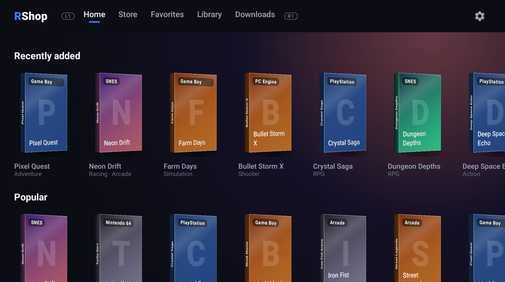
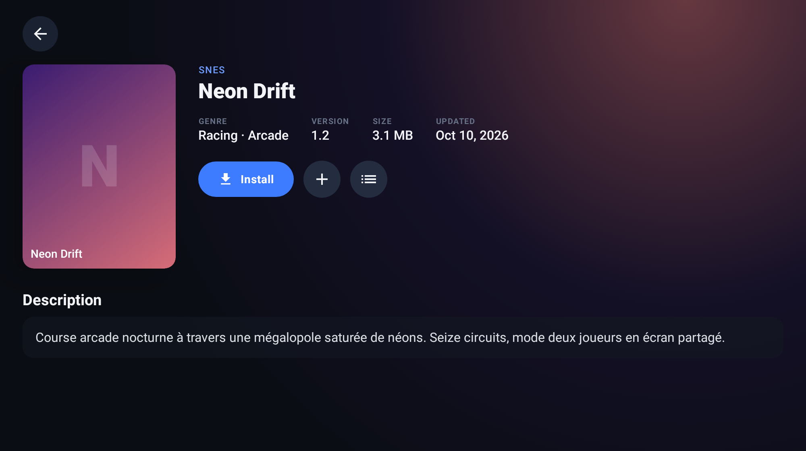
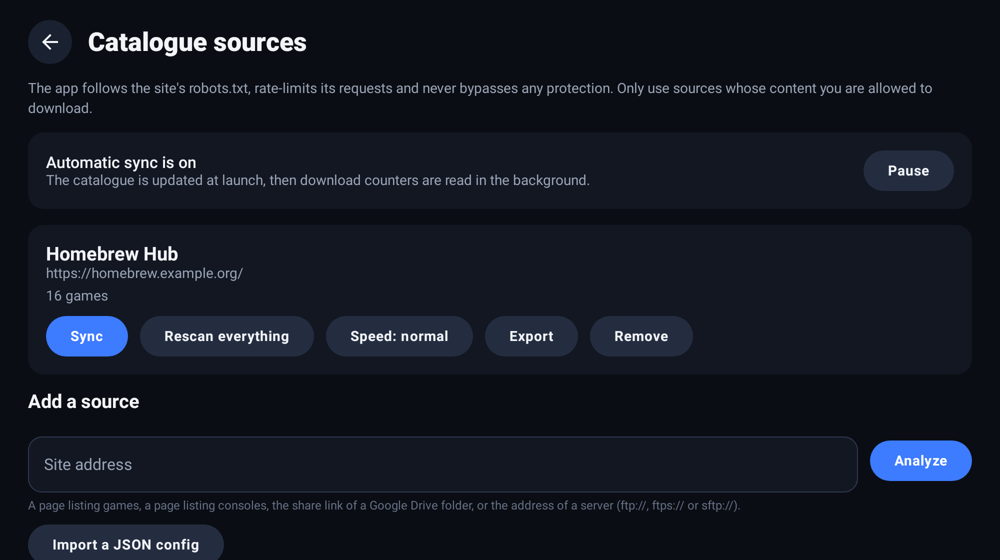
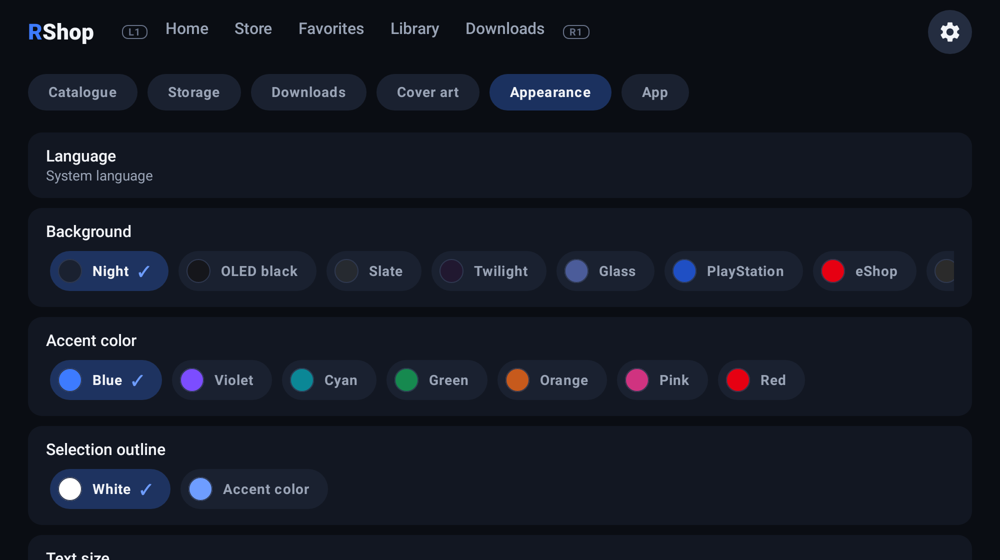

# RShop

**Website and download: https://animatrixex.github.io/RShop/**

**A game store for Android handhelds.** Browse a catalogue, download, install and manage games, with a console-style interface built for controllers.

RShop is **only a store and a download/install manager**. It does not launch games (that stays with your frontend or emulators) and it ships **no catalogue**: you add sources whose content you have the right to download (homebrew, your own creations, freely licensed content, your own server…).

Made for Retroid, Ayn, Anbernic and similar devices (16:9, gamepad); works on any Android 13+ phone or tablet.

| Home | Game page |
|---|---|
|  |  |
| **Catalogue sources** | **Appearance** |
|  |  |

*Screenshots use a fictional test site (`tools/testsite`).*

## Features

- **Sources**: websites, Google Drive folders, FTP / FTPS / SFTP servers and JSON APIs, synced in the background into a local database (works offline; later syncs only look for new games; you choose which consoles to fetch).
- **Store**: instant search, filters (platform, genre, source, hide installed/demos), sorting, lazy loading for huge catalogues.
- **Downloads**: background, pause/resume/cancel (also from the notification), retry, SHA-256 / MD5 check, battery and free-space guards.
- **Installation** into the folder(s) you pick (Storage Access Framework): zip, 7z, RAR/RAR5, tar and variants, protected against path traversal and zip bombs. Several formats or files per game (discs, bin + cue, updates) can be chosen and installed together.
- **Built-in browser** (GeckoView) for sites with intermediate pages: the file you click is captured and installed.
- **Favorites, custom lists, library** with update and delete; backup/restore of sources, lists and settings as one JSON file.
- **Covers, screenshots, descriptions** from the source, else from [Libretro thumbnails](https://thumbnails.libretro.com/), [SteamGridDB](https://www.steamgriddb.com/) (your own free key) and Wikipedia (credited, CC BY-SA).
- **Controller first**: visible focus, L1/R1 tabs, Y game menu, X search, button hints.
- **Themes**: dark, OLED, slate, twilight, Glass, PlayStation Store, eShop (light and dark), accent colors, text size, flat covers or 3D game boxes; French / English.
- **In-app update** from GitHub releases (SHA-256 checked), once a day or on demand.

## Install

1. Download `app-release.apk` from [Releases](../../releases) and open it. Or use [Obtainium](https://github.com/ImranR98/Obtainium): [add RShop](obtainium://add/https://github.com/AnimatrixEX/RShop).
2. *Settings → Storage* to pick a games folder, then *Settings → Catalogue → Sources → Add a source*.

Requires Android 13+ and an **arm64** CPU. About 200 MB, mostly GeckoView.

## Adding sources

- **Website**: paste the address of a page listing games (or consoles). RShop analyses it and proposes a configuration with a preview. The JSON config (`ScraperConfig`) can be imported/exported for tricky sites.
- **Google Drive**: paste the share link of a folder. Set up once, with your own free Google Cloud project, either a **Google sign-in** (private or shared-with-you folders; OAuth client of type *Desktop app*, you as test user; expires every 7 days while the Cloud app is in *Testing*) or an **API key** (folders shared with *Anyone with the link*). Console-named sub-folders (`GBA`, `PlayStation 2`…) become consoles; a Drive of game folders only asks which console. Drive gives only names, so artwork comes from the services above.
- **FTP / FTPS / SFTP**: paste `ftp://`, `ftps://` or `sftp://host/path` and enter the login (empty user = anonymous). Read like a Drive, downloads resume. Passwords are stored encrypted, never in a source file, export or backup. SFTP asks you to confirm the server key fingerprint the first time and refuses it if it changes; FTPS checks the certificate against Android's trust store; plain FTP shows a warning. SFTP is password-only for now.
- **JSON API**: import a `type: "json"` config (*Add a source → Import a config file*). `baseUrl`, `listUrl` (`{page}` or `{offset}`) and `detailsUrl` (`{id}`) are enough with the default field names; `searchUrl` (`{query}`) is optional, and each field's JSON path can be overridden.

  ```json
  { "type": "json", "id": "my-api", "name": "My catalogue",
    "baseUrl": "https://example.com/api/", "listUrl": "games?page={page}", "detailsUrl": "games/{id}",
    "searchUrl": "games?q={query}" }
  ```

  A list page looks like `{"games": [{"id": "zelda", "title": "Zelda", "cover": "…", "platform": "GBA", "size": 1048576}], "hasNext": true}` and a game like `{"game": {"id": "zelda", "title": "Zelda", "description": "…", "screenshots": ["…"], "downloads": [{"url": "files/zelda.zip", "sha256": "…"}]}}`. Downloads must stay on the API host unless `allowedDownloadHosts` lists others.

## Responsible use

The scraper (`:scraper`, pure JVM) respects `robots.txt`, rate-limits its requests, **never bypasses** CAPTCHAs, anti-bot protection, DRM, paywalls or logins, never silently downloads executables, and validates URLs, sizes, file types, hashes and extraction paths. Only add sources whose content you are allowed to use; you are responsible for what you download.

Version 0.2.4, personal project, tested on a Retroid Pocket 6. The game launcher is deliberately out of scope.
